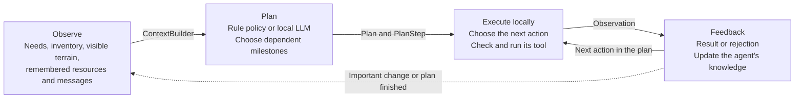

# bbagents

Python building blocks for agent systems: tools, planning, model selection, memory,
human approval, tracing, and evaluation. Works with LangGraph or your own runtime.

Companion code for *Agentic AI: Architecture, Theory, and Practice*.
[Buy the book](https://press.brilberry.com).

<a href="https://press.brilberry.com">
  
</a>

Requires Python 3.11+.

```sh
pip install -e '.[dev]'
pytest
```

## Survival Island example

Five autonomous survivors explore a seeded 30×30 island of forests, a central river, three lakes,
mountains, and grassland. Each has health, hunger, thirst, energy, an inventory,
a personal objective, a limited view of the world, remembered terrain and
resources, and a message inbox. They gather wood and berries, drink from rivers or lakes,
craft tools, and build shelters while their survival needs change over time.


### How it works

Each survivor repeats the same loop: observe what it knows, choose an action,
try it in the world, and use the result to decide what to do next.



For example, Ari needs shelter. She remembers a forest, moves there, and gathers
wood. If she becomes thirsty, she can interrupt that work to find water. If another
survivor has taken the last wood, the gather action is rejected; that feedback
helps her choose a different action next time. Survivors can also tell each other
where they found water. The central river remains, plus three separated lakes in different map regions, each
with a walkable shoreline, provide alternatives to a single central water corridor.

`bbagents` supplies the building blocks behind this loop:

- **Observation:** `ContextBuilder` assembles a bounded view of the survivor's
  situation and recent feedback for the model.
- **Decision:** `DecisionRuntime` validates a goal and 1–6 supported milestones,
  records attempts, and defers failed responses until the next eligibility window. Both policies use `Plan`
  and dependent `PlanStep` objects; local controllers execute each milestone.
- **Execution:** `ToolRegistry` exposes actions such as `move`, `gather`, and
  `build`. The game checks their preconditions again before changing the world.
- **Feedback:** tools return `Observation` objects. Results and failures feed the
  next model request; observed depletion updates the survivor's resource memory.
  The trace sink streams decisions and tool executions to disk for inspection.

You can run entirely with the rule policy or enable a local LLM through Ollama.
The model might return `gather_wood → build_shelter → rest`. That single response
can drive many movements and tool calls. Milestones keep completion state and
evidence; predators, fatigue, urgent needs, and night preparation pause model work
for immediate local responses. The reference policy also keeps agents active
while planning is pending. The sidebar shows plans, cache hits, and errors.

Voice, seasons, and disease are future additions.

### Inference and memory use

Model planning is event-driven: an initial or completed plan, new threats or water
knowledge, a lost home, depleted resources, and action failures can request a new
plan. There is no model call per action. Each survivor has seeded random intelligence
(0–100 scale): the initial group includes one at 85–100 and another at 5–20.
Intelligence controls both planning limits: smarter survivors wait closer to
**50 ticks and 20 seconds**, less intelligent survivors closer to **75 ticks and
40 seconds**. Tick delays receive ±2 ticks of jitter, clamped to 50–75; both
limits must expire, measured from processing the previous result (including failures).
Initial eligibility is staggered in separate 5–10 tick slots; new arrivals also
wait before their first request. Eligibility is permission to replan, not a forced
call. There is at most one gameplay request in flight, admitted fairly across
survivors. Invalid gameplay responses use local fallback until the next planning
window rather than immediately retrying. Emergency actions never wait for inference.
Intelligence affects access frequency, not model size or a guarantee of better
reasoning; it appears in the sidebar, model context, traces, and survivor reports.

Gameplay, retries, and postmortems share a gate that leaves **three seconds idle
after each inference call**. Increase it for a quieter machine:

```sh
python -m examples.survival_island.app --model qwen3.5:4b --inference-cooldown 6
```

Routine requests use an 8,192-token Ollama context and an 8,000-character snapshot
budget. `bbagents.optimization.Cache` reuses strategy proposals for matching known
state, with a 128-entry bound; changing inventory, position, resources, messages,
or coarse needs changes the key. Cached plans still use live action checks.

The full trace streams to JSONL files. RAM retains only the last 200 ticks of
events, capped at 30,000 events for unusually busy runs; old histories and
postmortems are read from disk. The trace file-handle cache is also bounded.
Plain headless `Simulation()` keeps its reference in-memory trace until a
`ReportManager` enables journaling. Model inference still uses the GPU, so this
reduces sustained work rather than guaranteeing silent operation.

### Predators and defense

The first wolf pack arrives at tick 250, with another arrival every 250 ticks:
a pack of **2–3 randomly chosen wolves**, another wolf pack, then one lone bear,
repeating. Defeated animals stay defeated; arrivals do not replace losses.
Wolves move/attack every four ticks; bears move every two ticks but can attack
only once every six ticks. Agents only
observe predators within their visibility range.

Wolves travel together and share a target when any pack member detects a survivor.
Each wolf has **45 health** and deals **7 damage** per attack (21 if all three land a hit). Bears
hunt independently and deal **30 damage** per attack, with **150 health**.
When members of different wolf packs meet on the same or adjacent tiles, both
packs merge, including distant packmates, and share a target. Merges can create
packs larger than three. Bears never join packs.

Predators have hunger and thirst (0–100). Below 40 hunger they roam calmly;
at 40/60/85 their hunting range grows to 2/6/10 tiles. Hungry wolves share prey,
but a well-fed packmate does not hunt just because another wolf does. A kill
reduces the killer's hunger by 65 and nearby packmates' by 45; nonfatal attacks
do not feed them. Attacking a calm predator provokes self-defense for 12 ticks.
Survivors can rest or sleep near calm animals rather than fleeing indefinitely.

At 55 thirst predators seek reachable riverbanks or lake shores and drink to reduce thirst by
65. At 85 thirst this takes priority even over adjacent prey. They navigate around
mountains without entering water, and continue drinking/roaming when no survivors
remain. Water navigation is a shared distance field, not model inference.
Hunger rises by 0.025 and thirst by 0.04 per tick—22× and 20× slower than awake
survivors. Only at 100 do they take need damage: 0.08 HP/tick for starvation and
0.12 for dehydration. Thus food/water deprivation takes much longer to kill them.
Arrivals have varied hunger (45–75) and thirst (10–35). Hover over W/B to inspect
HP, needs, and behavior; needs, drinking, feeding, and deaths are also traced.

Survivors can `craft("spear")` using three wood, `attack(predator_id)` when
adjacent, `flee()` two tiles at an energy cost, or `rest()` when no predator is
threatening. A spear deals 25 damage, an axe 12, and bare hands 5. Shelters reduce
incoming damage by 75%. Rest restores energy and slowly heals fed, hydrated agents.
Attacks cost 4 energy and have a three-tick cooldown, so a survivor cannot strike
repeatedly before a bear responds. The rule policy prefers fleeing when outnumbered,
injured, or facing a bear without two nearby allies.
Energy falls each tick and with activity: moving costs 1.2, gathering or crafting
costs 2, and building costs 6. Observation never restores energy. Explicit rest
restores 3 outdoors or 6 in a shelter. The rule policy interrupts work at 30 energy
and rests toward 70 before resuming, including while waiting for a model response.
The rule policy prepares spears when it has wood from tick 200, attacks adjacent
threats with a spear, and otherwise tries to flee. Immediate defense also overrides
pending model requests so inference latency does not prevent a response. Model
actions use the same tools, availability checks, observations, and traces.

Use `Simulation(predator_interval=None)` to disable predators for baseline
experiments, or set a different positive interval.

### New arrivals, shelter reuse, and lightning

Every **1,000 ticks**, another survivor spawns at a random walkable land tile on
the island's edge. New arrivals have their own identity, tools, limited knowledge,
plans, and memory. They begin by looking for shelter. Scroll the sidebar with the
mouse wheel or Page Up / Page Down to inspect more than five survivors.

The `claim_shelter()` tool lets a survivor take an unassigned shelter, one whose
owner died, or an older shelter its owner no longer calls home. It costs no wood;
an actively owned home cannot be taken. Builders reuse their existing home rather
than building a new shelter after each interruption.

**Lightning** has a 0.4% chance each tick (one strike per 250 ticks on average,
not a fixed schedule). When shelters exist, half of strikes target a shelter;
the rest hit a random tile. A struck shelter is destroyed, its home assignment
is cleared, and sleepers on that tile wake immediately. Lightning does not directly
damage health. A yellow bolt briefly marks the strike, and observations and traces
record the calamity. Its randomness is seeded for repeatable experiments.

For isolated experiments, `survivor_interval=None` disables new arrivals and
`lightning_probability=0` disables lightning.

### Sleep, interruption, and resuming work

From tick 44 of each 80-tick day, the rule policy pauses the survivor's current
plan and prepares for night: eat if hungry, drink if thirsty, reach a known safe
shelter if one is available, wait for night, then sleep. The same preparation
policy runs when a local model is enabled. If preparation becomes unsafe, survival
takes priority and the agent can skip that night's sleep.


The `sleep()` tool starts the activity once. The simulation advances it each tick
without selecting more actions, restoring **2.5 energy and 1 HP outdoors**, or
**5 energy and 2 HP in shelter**, per tick (capped at 100). Hunger and thirst
freeze while asleep, and passive fatigue/need damage pauses. Only **one survivor
can sleep per shelter**; night preparation avoids occupied shelters, and capacity
is released on waking or death. Multiple survivors may sleep outdoors.
Predators or externally changed hunger/thirst reaching 80 wake the agent
early; a predator attack also interrupts sleep immediately. Sleeping survivors
show a **z** on the map and a countdown in the sidebar.

This adds three framework demonstrations to the basic decision loop:

- **Versioned checkpoints:** `InMemoryStateStore` saves the suspended plan,
  including completed steps and their evidence, plus sleep status and progress.
  Each update supplies the expected version. Once urgent needs and danger are
  resolved, the survivor restores that plan instead of starting its objective over.
- **Episodic memory:** `MemoryStore` records where sleep completed or was interrupted.
  Night preparation consults those memories to avoid shelters associated with
  predator interruptions; recent sleep memories also enter model requests.
- **Lifecycle tracing:** `plan.suspended`, `sleep.started`, `sleep.progress`,
  `sleep.interrupted` / `sleep.completed`, and `plan.resumed` expose the transitions.

Sleep scheduling and interruption are game-owned tick logic, not framework async
task cancellation. Checkpoints and memories are in memory for this run; this
example does not yet restore a saved island after restarting the process. Model
plans retain their own progress while the checkpoint preserves the rule-policy
plan used for night preparation and survival responses.

### Traces and survivor postmortems

Close the window, press **Escape**, or interrupt with Ctrl+C to finish a run and
save its reports. Reports are also saved when a survivor dies; press **R** to save
an intermediate snapshot. The terminal prints the path to `index.md`, which links
to each survivor's history. By default, every run gets a unique directory under
`survival-runs/` (ignored by Git).
Reusing a report directory creates a new run subdirectory to preserve prior logs.

```sh
python -m examples.survival_island.app --model qwen3.5:4b \
  --report-dir survival-runs/my-experiment
```

Each directory contains:

- `index.md`: all survivors, their status, death tick, and recorded final cause.
- `agent-N.md`: that survivor's final needs and events from the last 200 ticks
  before death (or before the save for living survivors), plus the optional model
  postmortem for a deceased survivor—all in one Markdown file.
- `agent-N.jsonl`: the survivor's full event history, including received messages.
- `trace.jsonl`: the full run's framework trace, with simulation ticks, timestamps,
  and run/span correlation IDs.

The trace includes per-tick health, hunger, thirst, energy, inventory, location,
sleep, visible threats, plans, tool calls and results, model failures, communications,
damage, and deaths. Tool calls identify rule decisions, model decisions, and
waiting for inference. A fatal predator attack is recorded separately from
starvation, dehydration, or exhaustion damage, making the final cause inspectable.

With `--model`, a death automatically queues a background analysis using the same
Ollama model. It receives that survivor's events from the final 200 simulation ticks,
ending at the death tick, even if the game continues afterward. `ContextBuilder`
limits the input to 60,000 characters, prioritizing damage and death evidence;
the report states how many items were omitted if the window exceeds this budget.
`DecisionRuntime` validates the summary and requires evidence ticks to exist in
the supplied context. The explanation distinguishes the recorded cause, likely
contributors, and uncertainties; it is an interpretation, not proof of causation.

Raw reports are saved before model analysis. The window stays responsive while
summaries run. On exit the terminal may remain busy finishing queued analyses;
each request has a 90-second timeout and one retry. Model errors produce an error
report without discarding the raw history. Use `--no-postmortem` to keep model
gameplay enabled but save only the event reports. Without `--model`, event reports
are still generated and no summaries are requested.

### Run locally

From a checkout of this repository, using Python 3.11 or newer:

```sh
python3 -m venv .venv
source .venv/bin/activate
python -m pip install -e '.[game]'
python -m examples.survival_island.app
```

On Windows, activate with `.venv\Scripts\activate` instead. No model or API key is
needed for the reference policy.

Controls: **Space** pauses/resumes, **Right arrow** advances a tick while paused,
and **+ / -** changes simulation speed. The sidebar shows needs, inventory, plans,
recent actions, and events. The observer sees the full map; agents retain their
own limited knowledge.

To enable model decisions, start your Ollama server, download a model, and run:

```sh
ollama pull qwen3.5:9b
python -m examples.survival_island.app --model qwen3.5:9b
```

For a remote server:

```sh
python -m examples.survival_island.app --model qwen3.5:9b \
  --endpoint http://YOUR_SERVER:11434/api/chat
```

Local inference has no per-request API charges. Model downloads are explicit.
Start at 1–2 ticks per second to give the model time to deliberate as needs evolve.
Requests time out after 90 seconds; there is no tick-based expiry. Five survivors
share one model on the server. Use a model actually installed on that server
(`ollama list`), for example `--model qwen3.5:4b`.
`model.decision` and `model.failed` trace events distinguish model responses from
reference-policy actions.

The simulation also runs without pygame or a display:

```python
from examples.survival_island import Simulation

simulation = Simulation(seed=7)
for _ in range(1000):
    simulation.step()
print([(agent.name, agent.alive) for agent in simulation.agents])
```

Implementation: [simulation](examples/survival_island/simulation.py),
[model policy](examples/survival_island/model_policy.py),
[renderer](examples/survival_island/app.py), and
[tests](tests/test_survival_island.py).

## Features

The previous README's approval/recovery example is preserved as
[recoverable_release.py](examples/recoverable_release.py).

- Typed tools, dependency-checked plans, structured model decisions and validation.
- Per-agent model selection, routing constraints, cost estimates and caching.
- Capability policies, human intervention, explicit delegation and LangGraph interrupts.
- Bounded async execution, retry policies, execution journals and effect reconciliation.
- Versioned checkpoints, SQLite persistence, task budgets and completion gates.
- Budgeted context, summarization contracts and provider-neutral retrieval (RAG).
- Scoped, revisioned memory and skills; evaluated and approved procedure promotion.
- Roles, messages, delegation and organizational governance.
- Structured traces, isolated evaluation trials and compaction-continuation checks.
- Optional Ollama, LangChain, LangGraph, LangSmith and Langfuse integrations.

No mandatory runtime dependencies. Applications own domain behavior and adapters.

See [examples](examples/), [demos](demos/) and the [guide](GUIDE.md).
