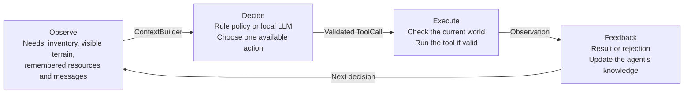

# bbagents

Python building blocks for agent systems: tools, planning, model selection, memory,
human approval, tracing, and evaluation. Works with LangGraph or your own runtime.

Companion code for *Agentic AI: Architecture, Theory, and Practice*.
[Buy the book](https://press.brilberry.com).

<a href="https://press.brilberry.com">
  
</a>

Requires Python 3.11+.

```sh
pip install -e '.[dev]'
pytest
```

## Survival Island example

Five autonomous survivors explore a seeded 30×30 island of forests, rivers,
mountains, and grassland. Each has health, hunger, thirst, energy, an inventory,
a personal objective, a limited view of the world, remembered terrain and
resources, and a message inbox. They gather wood and berries, drink from rivers,
craft tools, and build shelters while their survival needs change over time.


### How it works

Each survivor repeats the same loop: observe what it knows, choose an action,
try it in the world, and use the result to decide what to do next.



For example, Ari needs shelter. She remembers a forest, moves there, and gathers
wood. If she becomes thirsty, she can interrupt that work to find water. If another
survivor has taken the last wood, the gather action is rejected; that feedback
helps her choose a different action next time. Survivors can also tell each other
where they found a river.

`bbagents` supplies the building blocks behind this loop:

- **Observation:** `ContextBuilder` assembles a bounded view of the survivor's
  situation, recent results, and available actions for the model.
- **Decision:** `DecisionRuntime` validates model output and action preconditions,
  retries a failed decision once, and records attempts. The rule policy instead
  follows a `Plan` made of dependent `PlanStep` objects.
- **Execution:** `ToolRegistry` exposes actions such as `move`, `gather`, and
  `build`. The game checks their preconditions again before changing the world.
- **Feedback:** tools return `Observation` objects. Results and failures feed the
  next model request; observed depletion updates the survivor's resource memory.
  `InMemoryTrace` records the model decisions and tool executions for inspection.

You can run entirely with the rule policy or enable a local LLM through Ollama.
Model requests run in the background while the game continues. Waiting agents
observe/rest; urgent needs and failed requests use the rule policy. The sidebar
shows model proposal counts and errors, with full errors in the terminal.

**Current limitation:** the LLM proposes one action per response. Its longer plan
is displayed and reconsidered on later responses, but is not automatically
executed as a sequence. Voice, weather, seasons, disease, and predators are future
additions.

### Run locally

From a checkout of this repository, using Python 3.11 or newer:

```sh
python3 -m venv .venv
source .venv/bin/activate
python -m pip install -e '.[game]'
python -m examples.survival_island.app
```

On Windows, activate with `.venv\Scripts\activate` instead. No model or API key is
needed for the reference policy.

Controls: **Space** pauses/resumes, **Right arrow** advances a tick while paused,
and **+ / -** changes simulation speed. The sidebar shows needs, inventory, plans,
recent actions, and events. The observer sees the full map; agents retain their
own limited knowledge.

To enable model decisions, start your Ollama server, download a model, and run:

```sh
ollama pull qwen3.5:9b
python -m examples.survival_island.app --model qwen3.5:9b
```

For a remote server:

```sh
python -m examples.survival_island.app --model qwen3.5:9b \
  --endpoint http://YOUR_SERVER:11434/api/chat
```

Local inference has no per-request API charges. Model downloads are explicit.
Start at 1–2 ticks per second to give the model time to deliberate as needs evolve.
Requests time out after 90 seconds; there is no tick-based expiry. Five survivors
share one model on the server. Use a model actually installed on that server
(`ollama list`), for example `--model qwen3.5:4b`.
`model.decision` and `model.failed` trace events distinguish model responses from
reference-policy actions.

The simulation also runs without pygame or a display:

```python
from examples.survival_island import Simulation

simulation = Simulation(seed=7)
for _ in range(1000):
    simulation.step()
print([(agent.name, agent.alive) for agent in simulation.agents])
```

Implementation: [simulation](examples/survival_island/simulation.py),
[model policy](examples/survival_island/model_policy.py),
[renderer](examples/survival_island/app.py), and
[tests](tests/test_survival_island.py).

## Features

The previous README's approval/recovery example is preserved as
[recoverable_release.py](examples/recoverable_release.py).

- Typed tools, dependency-checked plans, structured model decisions and validation.
- Per-agent model selection, routing constraints, cost estimates and caching.
- Capability policies, human intervention, explicit delegation and LangGraph interrupts.
- Bounded async execution, retry policies, execution journals and effect reconciliation.
- Versioned checkpoints, SQLite persistence, task budgets and completion gates.
- Budgeted context, summarization contracts and provider-neutral retrieval (RAG).
- Scoped, revisioned memory and skills; evaluated and approved procedure promotion.
- Roles, messages, delegation and organizational governance.
- Structured traces, isolated evaluation trials and compaction-continuation checks.
- Optional Ollama, LangChain, LangGraph, LangSmith and Langfuse integrations.

No mandatory runtime dependencies. Applications own domain behavior and adapters.

See [examples](examples/), [demos](demos/) and the [guide](GUIDE.md).
