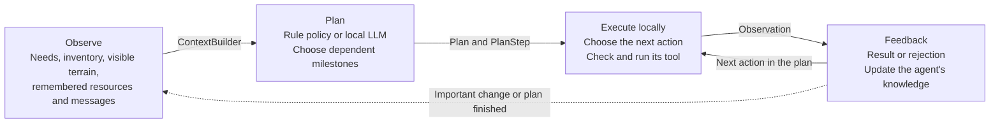
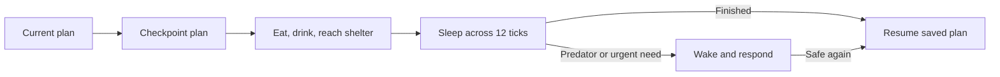

# Survival Island: overview and running the simulation


Survivors now learn gardening, fire-making/cooking, skinning/leatherworking, and
reservoir construction through a shared bbagents skill catalog. Wildlife and
survivors compete for finite food stocks. See the [survival-systems guide](SURVIVAL_SYSTEMS.md)
for prerequisites, recipes, tool commands, resource costs, and planning behavior.

Seeded seasons and weather now affect survival: spring is the default mild start,
summer can bring heatwaves, autumn is wetter, and winter can bring snow and fatal
cold exposure. Shelters reduce cold and heat effects. Competitions can set
`starting_season` to `spring`, `summer`, `autumn`, or `winter` in their JSON.

Solo shelters reserve sleep access for their owner; shared shelters admit visitors
up to bed capacity. Abandoned shelters must be claimed before sleeping there.

Press **H** in the game window to show all keyboard shortcuts. Help pauses the
simulation; **H**, **Escape**, or **Close** dismisses it without changing the
previous pause state.

Seeded deer, boars, and rabbits roam from the start. Survivors can learn bow-making
and hunting, pursue visible prey, and collect meat; prey can escape, shots can
miss, and provoked boars retaliate. See [wildlife and hunting](README.md#wildlife-and-hunting).

Animal water-crossing limits are three consecutive tiles for bears, one for
wolves/deer/boars, and zero for rabbits. All drink from shore; swimmers can drink
inside water. Hungry bears can opportunistically eat nearby deer and rabbits.

Players can submit a JSON5 team with a shared attribute budget and compete across
identical seeded environments using a separate competition JSON. See the
[complete configuration reference](CONFIGURATION.md)
for runnable commands, supported values, map presets, and team-survival scoring.

Survivors can also discover fishing through intelligence and personal survival
time, or learn it through local information exchanges. Learned survivors craft
rods and catch fish at lakes as an alternative to berries. See the
[example guide](README.md#learning-to-fish) for rules.

Five autonomous survivors explore a seeded 30×30 island of forests, a central river, three lakes,
mountains, and grassland. Each has health, hunger, thirst, energy, an inventory,
a personal objective, a limited view of the world, remembered terrain and
resources, and a message inbox. They gather wood and berries, drink from rivers or lakes,
craft tools, and build shelters while their survival needs change over time.

Survivors are **independent generalists**, not assigned builders, scouts, or food
providers. They spawn apart with no knowledge of one another. Each chooses its own
current priority from local knowledge and needs: find water, establish a home,
stock food, explore, or invest in useful learned tools. Losing a shelter or running
out of food changes that priority; emergencies and sleep still take precedence.
Every survivor has the same tools, so losing one never removes a specialist's
capability from the population.

Seeing another survivor creates an encounter memory. Communication requires a
previously encountered survivor who is currently within visibility—there is no
global roster, telepathy, or automatic water broadcast. Each survivor has seeded
**generosity, cooperation, and caution**. Its policy can ask questions, answer for
free, quote a price, propose a trade, or invite a construction partner—and the
other survivor can refuse. Model context includes only encountered survivors and
voluntarily advertised supplies; inference limits still apply.


### How it works

Each survivor repeats the same loop: observe what it knows, choose an action,
try it in the world, and use the result to decide what to do next.



For example, Ari needs shelter. She remembers a forest, moves there, and gathers
wood. If she becomes thirsty, she can interrupt that work to find water. If another
survivor has taken the last wood, the gather action is rejected; that feedback
helps her choose a different action next time. Survivors can also tell each other
where they found water. The central river remains, plus three separated lakes in different map regions, each
with a walkable shoreline, provide alternatives to a single central water corridor.

`bbagents` supplies the building blocks behind this loop:

- **Observation:** `ContextBuilder` assembles a bounded view of the survivor's
  situation and recent feedback for the model.
- **Decision:** `DecisionRuntime` validates a goal and 1–6 supported milestones,
  records attempts, and defers failed responses until the next eligibility window. Both policies use `Plan`
  and dependent `PlanStep` objects; local controllers execute each milestone.
- **Execution:** `ToolRegistry` exposes actions such as `move`, `gather`, and
  `build`. The game checks their preconditions again before changing the world.
- **Feedback:** tools return `Observation` objects. Results and failures feed the
  next model request; observed depletion updates the survivor's resource memory.
  The trace sink streams decisions and tool executions to disk for inspection.

You can run entirely with the rule policy or enable a local LLM through Ollama.
The model might return `gather_wood → build_shelter → rest`. That single response
can drive many movements and tool calls. Milestones keep completion state and
evidence; predators, fatigue, urgent needs, and night preparation pause model work
for immediate local responses. The reference policy also keeps agents active
while planning is pending. The sidebar shows plans, cache hits, and errors.

Voice and disease are future additions; seasons and weather are implemented.

### Inference and memory use

Model planning is event-driven: an initial or completed plan, new threats or water
knowledge, a lost home, depleted resources, and action failures can request a new
plan. There is no model call per action. Each survivor has seeded random intelligence
(0–100 scale): the initial group includes one at 85–100 and another at 5–20.
Intelligence controls both planning limits: smarter survivors wait closer to
**50 ticks and 20 seconds**, less intelligent survivors closer to **75 ticks and
40 seconds**. Tick delays receive ±2 ticks of jitter, clamped to 50–75; both
limits must expire, measured from processing the previous result (including failures).
Initial eligibility is staggered in separate 5–10 tick slots.
Eligibility is permission to replan, not a forced
call. There is at most one gameplay request in flight, admitted fairly across
survivors. Invalid gameplay responses use local fallback until the next planning
window rather than immediately retrying. Emergency actions never wait for inference.
Intelligence affects access frequency, not model size or a guarantee of better
reasoning; it appears in the sidebar, model context, traces, and survivor reports.

Gameplay, retries, and postmortems share a gate that leaves **three seconds idle
after each inference call**. Increase it for a quieter machine:

```sh
python -m examples.survival_island.app --model qwen3.5:4b --inference-cooldown 6
```

Routine requests use an 8,192-token Ollama context and a 14,000-character snapshot
budget. `bbagents.optimization.Cache` reuses strategy proposals for matching known
state, with a 128-entry bound; changing inventory, position, resources, messages,
or coarse needs changes the key. Cached plans still use live action checks.

The full trace streams to JSONL files. RAM retains only the last 200 ticks of
events, capped at 30,000 events for unusually busy runs; old histories and
postmortems are read from disk. The trace file-handle cache is also bounded.

### Individual collaboration and exchanges

Survival comes first. Otherwise, individual policies can use these tools during
local encounters. Replies and consent each consume an action; nobody is forced
to cooperate or wait idle for an answer.

| Action | What happens |
| --- | --- |
| `communicate(id, message)` | Ask about water, food, wood, or shelter; answer from memory, decline, or quote a price. Survivors may also advertise their supplies. |
| `trade(id, offer, request)` | Propose an item-for-item exchange; gifts are possible with an empty request. |
| `collaborate(id, {"position": [x, y]})` | Invite a partner to a shared shelter project at a nearby observed grass tile. |
| `respond_offer(offer_id, accept)` | Explicitly accept or reject the exact terms. |
| `cancel_offer(offer_id)` | Withdraw your pending proposal. |
| `work_project(project_id)` / `leave_project(project_id)` | Contribute materials/work, or leave previous contributions intact. |

Offers expire after **32 ticks**, with at most four pending per participant.
They do not reserve inventory: both inventories, consent, location, and life/sleep
state are checked again at acceptance. Item exchange happens atomically on the
simulation thread and cannot be accepted twice. Paid information stays hidden
from the buyer's context until payment and disclosure succeed together. Information
must come from the provider's memory; it may be stale, but fabrication is not
supported. A refusal or cancelled/expired offer transfers nothing.

Craft a `flask` with two wood. `collect_water()` fills an empty flask at water;
the `water` inventory item represents a full flask and can be traded. `use_water()`
reduces thirst by 50 and returns an empty flask. Trading a full flask transfers
its container too. Policies use advertised supplies, not hidden peer inventories.

**Construction now takes work over multiple ticks**, including solo construction:

| Shelter | Wood | Work actions | Construction energy | Beds |
| --- | ---: | ---: | ---: | ---: |
| Solo | 10 | 4 | 6 total | 1 |
| Shared | 14 | 6 | 9 total; 4.5 each if split evenly | 2 |

Each builder contributes at most one work action per tick at the project site.
With materials ready, two builders finish the shared shelter in three ticks versus
four for a solo shelter. Both become residents. Materials and completed work remain
if a partner leaves or dies; remaining members may invite a replacement, and an
abandoned project can be adopted through `build("shelter")`. An individual may
leave after 96 + cooperation ticks without progress, rather than waiting forever.
Urgent needs, threats, and sleep pause work; they do not erase it. Sleeping capacity
is enforced per bed, and a surviving resident keeps their home if a partner dies.

The model may add one optional `{ "social": { "tool": ..., "arguments": ... } }`
action to its goal/milestone response. It becomes a dependent `PlanStep` and passes
the same world checks as reference-policy actions. Social proposals are not cached.
They use ordinary planning requests, not a separate model call per interaction;
new offers may request replanning but cannot bypass tick/time cooldowns.
While an eligible model request is pending, the survivor keeps acting; local
consent takes over when an offer has eight ticks left, so slow inference cannot
leave it waiting forever.
Hover over a survivor for traits/offers, or a shelter for its beds. Gold outlines
mark construction sites. Offer decisions, payments, disclosure, contributions,
departures, and completion appear in survivor traces and reports.

**Framework usage and boundary:** `ActionRuntime` and `AuthorizationDecision`
check actor-bound social actions; `ToolRegistry` exposes them; typed organizational
messages carry data, not executable instructions. `Plan`/`PlanStep` track each
builder's work, `InMemoryStateStore` provides version checks, and `MemoryStore`/
`Provenance` retain social experience and externally supplied facts. `DecisionRuntime`
and `ContextBuilder` validate and bound model proposals. bbagents does not yet have
a generic multi-party offer/transaction protocol: this game's serial, in-memory
implementation lives in `social.py`. It is not a distributed transaction service
or a durable full-game recovery system.
Plain headless `Simulation()` keeps its reference in-memory trace until a
`ReportManager` enables journaling. Model inference still uses the GPU, so this
reduces sustained work rather than guaranteeing silent operation.

### Predators and defense

The first wolf pack arrives at tick 250, with another arrival every 250 ticks:
a pack of **2–3 randomly chosen wolves**, another wolf pack, then one lone bear,
repeating. Defeated animals stay defeated; arrivals do not replace losses.
Wolves move/attack every four ticks; bears move every two ticks but can attack
only once every six ticks. Agents only
observe predators within their visibility range.

Wolves travel together and share a target when any pack member detects a survivor.
Each wolf has **45 health** and deals **7 damage** per attack (21 if all three land a hit). Bears
hunt independently and deal **30 damage** per attack, with **150 health**.
When members of different wolf packs meet on the same or adjacent tiles, both
packs merge, including distant packmates, and share a target. Merges can create
packs larger than three. Bears never join packs.

Predators have hunger and thirst (0–100). Below 40 hunger they roam calmly;
at 40/60/85 their hunting range grows to 2/6/10 tiles. Hungry wolves share prey,
but a well-fed packmate does not hunt just because another wolf does. A kill
reduces the killer's hunger by 65 and nearby packmates' by 45; nonfatal attacks
do not feed them. Attacking a calm predator provokes self-defense for 12 ticks.
Survivors can rest or sleep near calm animals rather than fleeing indefinitely.

At 55 thirst predators seek reachable riverbanks or lake shores and drink to reduce thirst by
65. At 85 thirst this takes priority even over adjacent prey. They navigate around
mountains without entering water, and continue drinking/roaming when no survivors
remain. Water navigation is a shared distance field, not model inference.
Hunger rises by 0.025 and thirst by 0.04 per tick—22× and 20× slower than awake
survivors. Only at 100 do they take need damage: 0.08 HP/tick for starvation and
0.12 for dehydration. Thus food/water deprivation takes much longer to kill them.
Arrivals have varied hunger (45–75) and thirst (10–35). Hover over W/B to inspect
HP, needs, and behavior; needs, drinking, feeding, and deaths are also traced.

Survivors can `craft("spear")` using three wood, `attack(predator_id)` when
adjacent, `flee()` two tiles at an energy cost, or `rest()` when no predator is
threatening. A spear deals 25 damage, an axe 12, and bare hands 5. Intact shelters
block all animal entry and attacks. Rest restores energy and slowly heals fed, hydrated agents.
An exhausted survivor with less than 3 energy can catch their breath even under
threat, without healing or protection from attacks. Before doing so, the defensive
policy drinks carried/reachable water or eats carried food when needs are urgent;
once energy recovers, escape resumes instead of repeatedly observing until death.
Landing the killing blow automatically grants a one-time food/hydration reward:
wolves reduce the killer's hunger by 30 and thirst by 10; bears by 50 and 20.
Needs cannot fall below zero. Nonfatal hits grant nothing; rewards are recorded
in tool feedback and `survivor.kill_reward` trace events.
Attacks cost 4 energy and have a three-tick cooldown, so a survivor cannot strike
repeatedly before a bear responds. The rule policy prefers fleeing when outnumbered,
injured, or facing a bear without two nearby allies.
Energy falls each tick and with activity: moving costs 1.2, gathering or crafting
costs 2, and construction work costs 1.5 per action. Observation never restores energy. Explicit rest
restores 3 outdoors or 6 in a shelter. The rule policy interrupts work at 30 energy
and rests toward 70 before resuming, including while waiting for a model response.
Axes and spears require learned recipes, discovered through intelligence,
experience and remembered resources, or taught by nearby survivors. Tool projects
are need-driven rather than a mandatory progression: gathering demand justifies
an axe, while recent danger or cautious preparation justifies a spear.
The rule policy attacks adjacent
threats with a spear, and otherwise tries to flee. Immediate defense also overrides
pending model requests so inference latency does not prevent a response. Model
actions use the same tools, availability checks, observations, and traces.

Use `Simulation(predator_interval=None)` to disable predators for baseline
experiments, or set a different positive interval.

### Shelter reuse and lightning

When the last survivor dies, the run ends immediately: ticks, weather,
and predators stop advancing. The window stays open on the final state with
“Game over”; pause/resume and single-step cannot restart it. Reports are saved,
queued model postmortems finish in the background, and final logs are flushed.
Headless `Simulation.step()` also stops advancing after game over.

No additional survivors arrive. A team's initial members are its only survivors.

A deceased survivor's remaining inventory becomes a stash at its valid home.
Claiming the abandoned shelter inherits its resources and tools exactly once.
Shared homes remain occupied while a living resident remains; residents retain
their rights and can collect the deceased's stash. Lightning destroys stored
contents with the shelter. Skills are learned, not inherited with equipment.

The `claim_shelter()` tool lets a survivor take an unassigned shelter, one whose
owner died, or an older shelter its owner no longer calls home. It costs no wood;
an actively owned home cannot be taken. Builders reuse their existing home rather
than building a new shelter after each interruption.

**Lightning** has a 0.4% base chance each tick, multiplied by 1 in normal rain,
3 in thunderstorms and 0.25 otherwise. Every tile has the same chance of being targeted, regardless
of shelters or terrain (1/900 per strike on a 30×30 map). A struck shelter is destroyed, its home assignment
is cleared, and sleepers on that tile wake immediately. Lightning does not directly
damage health. A yellow bolt briefly marks the strike, and observations and traces
record the calamity. Its randomness is seeded for repeatable experiments.

For isolated experiments, `lightning_probability=0` disables lightning.

### Sleep, interruption, and resuming work

From tick 44 of each 80-tick day, the rule policy pauses the survivor's current
plan and prepares for night: eat if hungry, drink if thirsty, reach a known safe
shelter if one is available, wait for night, then sleep. The same preparation
policy runs when a local model is enabled. If preparation becomes unsafe, survival
takes priority and the agent can skip that night's sleep.



The `sleep()` tool starts the activity once. The simulation advances it each tick
without selecting more actions, restoring **2.5 energy and 1 HP outdoors**, or
**5 energy and 2 HP in shelter**, per tick (capped at 100). Hunger and thirst
freeze while asleep, and passive fatigue/need damage pauses. Each bed accommodates
one sleeper (one bed for solo shelters, two for shared shelters); preparation avoids full shelters, and capacity
is released on waking or death. Multiple survivors may sleep outdoors.
Predators or externally changed hunger/thirst reaching 80 wake the agent
early; a predator attack also interrupts sleep immediately. Sleeping survivors
show a **z** on the map and a countdown in the sidebar.

This adds three framework demonstrations to the basic decision loop:

- **Versioned checkpoints:** `InMemoryStateStore` saves the suspended plan,
  including completed steps and their evidence, plus sleep status and progress.
  Each update supplies the expected version. Once urgent needs and danger are
  resolved, the survivor restores that plan instead of starting its objective over.
- **Episodic memory:** `MemoryStore` records where sleep completed or was interrupted.
  Night preparation consults those memories to avoid shelters associated with
  predator interruptions; recent sleep memories also enter model requests.
- **Lifecycle tracing:** `plan.suspended`, `sleep.started`, `sleep.progress`,
  `sleep.interrupted` / `sleep.completed`, and `plan.resumed` expose the transitions.

Sleep scheduling and interruption are game-owned tick logic, not framework async
task cancellation. Checkpoints and memories are in memory for this run; this
example does not yet restore a saved island after restarting the process. Model
plans retain their own progress while the checkpoint preserves the rule-policy
plan used for night preparation and survival responses.

### Traces and survivor postmortems

After the final survivor dies, the **Game Over** dialog has a **Generate
postmortem** button (Enter also works). It finishes pending model summaries in
the background, retains the Markdown report, and creates `survival-report.html`
beside it, opening the HTML automatically in your default browser. Without a
model it still exports all recorded evidence. The HTML has expandable event logs
and treats messages/model output as inert text. Generation errors allow a retry;
if browser launch fails, the saved path is printed for manual opening.

Close the window, press **Escape**, or interrupt with Ctrl+C to finish a run and
save its reports. Reports are also saved when a survivor dies; press **R** to save
an intermediate snapshot. The terminal prints the path to `survival-report.md`,
which contains every survivor's history. By default, every run gets a unique directory under
`survival-runs/` (ignored by Git).
Reusing a report directory creates a new run subdirectory to preserve prior logs.

```sh
python -m examples.survival_island.app --model qwen3.5:4b \
  --report-dir survival-runs/my-experiment
```

Each run produces one self-contained `survival-report.md`: an overview and
contents list, every survivor's status, death tick/cause, final needs, inventory,
skills, final 200 ticks, optional model postmortem, and the complete run's event
history in an embedded JSONL section, with timestamps and run/span correlation
IDs. No separate index, survivor reports, or JSONL exports are needed. The Game
Over button optionally adds an HTML rendering of the same report. Internal
temporary disk journals preserve bounded memory during play; report writes are
streamed and atomically replaced. Existing reports from older runs are not deleted.

The trace includes per-tick health, hunger, thirst, energy, inventory, location,
sleep, visible threats, plans, tool calls and results, model failures, communications,
damage, and deaths. Tool calls identify rule decisions, model decisions, and
waiting for inference. A fatal predator attack is recorded separately from
starvation, dehydration, or exhaustion damage, making the final cause inspectable.

With `--model`, a death automatically queues a background analysis using the same
Ollama model. It receives that survivor's events from the final 200 simulation ticks,
ending at the death tick, even if the game continues afterward. `ContextBuilder`
limits the input to 60,000 characters, prioritizing damage and death evidence;
the report states how many items were omitted if the window exceeds this budget.
`DecisionRuntime` validates the summary and requires evidence ticks to exist in
the supplied context. The explanation distinguishes the recorded cause, likely
contributors, and uncertainties; it is an interpretation, not proof of causation.

Raw reports are saved before model analysis. The window stays responsive while
summaries run. On exit the terminal may remain busy finishing queued analyses;
each request has a 90-second timeout and one retry. Model errors produce an error
report without discarding the raw history. Use `--no-postmortem` to keep model
gameplay enabled but save only the event reports. Without `--model`, event reports
are still generated and no summaries are requested.

### Run locally

From a checkout of this repository, using Python 3.11 or newer:

```sh
python3 -m venv .venv
source .venv/bin/activate
python -m pip install -e '.[game]'
python -m examples.survival_island.app
```

On Windows, activate with `.venv\Scripts\activate` instead. No model or API key is
needed for the reference policy.

Controls: **Space** pauses/resumes, **Right arrow** advances a tick while paused,
and **+ / -** changes simulation speed. The sidebar shows needs, inventory, plans,
recent actions, and events. The observer sees the full map; agents retain their
own limited knowledge.

To enable model decisions, start your Ollama server, download a model, and run:

```sh
ollama pull qwen3.5:9b
python -m examples.survival_island.app --model qwen3.5:9b
```

For a remote server:

```sh
python -m examples.survival_island.app --model qwen3.5:9b \
  --endpoint http://YOUR_SERVER:11434/api/chat
```

Local inference has no per-request API charges. Model downloads are explicit.
Start at 1–2 ticks per second to give the model time to deliberate as needs evolve.
Requests time out after 90 seconds; there is no tick-based expiry. Five survivors
share one model on the server. Use a model actually installed on that server
(`ollama list`), for example `--model qwen3.5:4b`.
`model.decision` and `model.failed` trace events distinguish model responses from
reference-policy actions.

The simulation also runs without pygame or a display:

```python
from examples.survival_island import Simulation

simulation = Simulation(seed=7)
for _ in range(1000):
    simulation.step()
print([(agent.name, agent.alive) for agent in simulation.agents])
```

Implementation: [simulation](simulation.py),
[model policy](model_policy.py),
[renderer](app.py), and
[tests](../../tests/test_survival_island.py).
